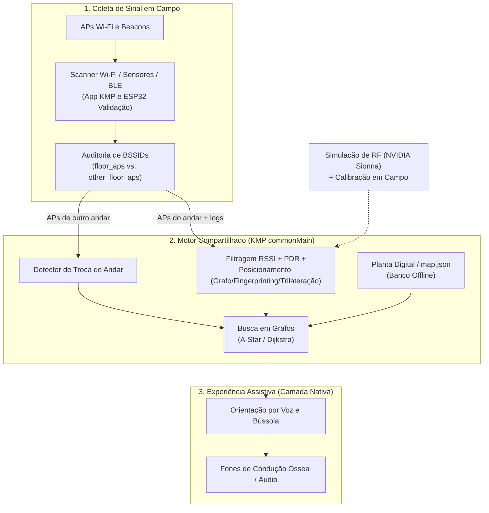

# [NOME DO PROJETO 1]

[]()
[]()
[]()

> **Navegação indoor assistiva por Wi-Fi e áudio** para orientar pessoas com deficiência visual ou baixa visão dentro de edifícios onde o GPS tradicional não funciona.

*(Nome provisório no repositório: `Sonaris` / citado na documentação inicial como `Accessway` — nome definitivo em votação pelo grupo.)*

---

## O Problema e a Solução

Ambientes fechados (prédios acadêmicos, centros públicos, corredores com múltiplas salas) não contam com cobertura confiável de GPS por satélite. O **[NOME DO PROJETO 1]** transforma a infraestrutura de roteadores Wi-Fi já existente no prédio em um sistema de localização e guia em tempo real:

1. **Detecção e auditoria de redes Wi-Fi:** captura de `SSID`, `BSSID` (MAC do rádio) e força de sinal (`RSSI`), com logs de auditoria para separar pontos de acesso do andar atual (`floor_aps`), sinais de outros andares (`other_floor_aps`) e redes externas.
2. **Posicionamento indoor adaptável ao prédio:** estimativa de posição preparada tanto para o cenário atual com **2 APs no andar** (via restrição no grafo com Odometria de Pedestre ou *Wi-Fi Fingerprinting*, usando sinais de outros andares apenas para detectar mudança de pavimento) quanto para **trilateração** com 3 ou mais APs.
3. **Roteamento acessível em grafos:** cálculo de rota sobre a planta digital do prédio (`map.json`), indicando onde a pessoa está e guiando até o destino desejado.
4. **Saída auditiva não intrusiva:** instruções de voz claras com suporte previsto a **fones de condução óssea**, preservando a audição do ambiente ao redor.

---

## Estágio e Planejamento do Projeto

### Já produzido (Fases 1 e 2)
- [x] Detecção das redes Wi-Fi
- [x] Identificação dos pontos de acesso (`BSSID`, `SSID`, `RSSI`)
- [x] Logs de acesso usados como auditoria para validar quais pontos de acesso pertencem ao andar

### Em andamento (Sprint atual)
- [ ] Consolidação das **Fases 0 a 2** de estudos em Kotlin e transição do aplicativo para **Kotlin Multiplatform (KMP)**
- [ ] Classificação auditada de `BSSIDs` (`floor_aps` vs. `other_floor_aps`) e estruturação do `map.json` com grafo do corredor (**Fase 1**)
- [ ] Validação com **ESP32** (auditoria em 2.4 GHz e avaliação de uso como 3º ponto `SoftAP` ou `Beacon BLE`)
- [ ] Estudo de viabilidade de 3º ponto de acesso e simulação de propagação (referência: NVIDIA Sionna)

### Planejamento das próximas etapas (Fases 2 a 6)
- [ ] **Fase 2 (Motor de Posicionamento):** filtragem de `RSSI` (Média Móvel / Kalman), posicionamento para 2 APs (restrição pelo grafo + Odometria de Pedestre / PDR ou *Wi-Fi Fingerprinting*), detector de troca de andar e seleção dos 3 melhores APs quando houver 3 ou mais disponíveis
- [ ] **Fase 3 (Roteamento e Busca):** algoritmo de menor caminho sobre o grafo (`A-Star` / `Dijkstra`) e conversão da rota em instruções naturais
- [ ] **Fase 4 (UX Assistiva):** interface de voz, orientação egocêntrica por bússola, acessibilidade com TalkBack e suporte a fones de condução óssea
- [ ] **Fase 5 (Arquitetura e Armazenamento):** persistência offline de mapas e assinaturas Wi-Fi com fluxo assíncrono em Kotlin Coroutines e Flow
- [ ] **Fase 6 (Validação em Campo):** calibração de atenuação real em corredores, medição da margem de erro em metros e testes assistivos

---

## Visão Geral de Arquitetura



Resumo em texto da arquitetura (acessível para leitores de tela):
1. Coleta de sinal em campo (camada nativa e bancada): o scanner Wi-Fi, leitura BLE e sensores de movimento no app (`androidMain` e `iosMain` via `expect`/`actual`) e o módulo de validação em ESP32 geram leituras no mesmo formato de auditoria.
2. Motor compartilhado em KMP (`commonMain`): separa `BSSIDs` do andar atual (`floor_aps`) dos sinais de outros pavimentos (`other_floor_aps`, usados apenas para detectar troca de andar), aplica filtragem de `RSSI`, integra Odometria de Pedestre (PDR), estima a posição por restrição no grafo, *Fingerprinting* ou trilateração sobre o `map.json` e calcula rotas com `A-Star` ou `Dijkstra`.
3. Saída assistiva (camada nativa): traduz o caminho em comandos de voz relativos à orientação do usuário, com suporte a TalkBack e fones de condução óssea.
4. Calibração em simulação e campo: estudos com NVIDIA Sionna e testes presenciais calibram atenuação e margem de erro.

### Estrutura Atual e Planejada do Projeto

**Estrutura atual neste repositório:**

```text
.
├── .gitignore                               # Regras para Python/Jupyter, Kotlin/KMP/Gradle e IDEs
├── docs/                                    # Roteiro de estudos migrado (Fase 0.ipynb a Fase 6.ipynb, README.md, guia VS Code)
├── estudos/                                 # Estudos complementares, trilateração, simulações e Journal Club
├── org-github/                              # Documentos de governança, fluxo e estratégia mantidos nesta entrega
│   ├── profile-README.md                    # Base da página principal da organização (para .github/profile/README.md)
│   ├── CONTRIBUTING.md                      # Fluxo de sprints, acessibilidade, branches, commits e PRs (para .github/)
│   ├── PULL_REQUEST_TEMPLATE.md             # Template padrão de Pull Request (para .github/)
│   ├── ISSUE_TEMPLATE-implementacao.md      # Template de issue de implementação (para .github/ISSUE_TEMPLATE/)
│   ├── template-estudo-fase-0.md            # Template acessível para Fase 0 no repositório estudos
│   ├── template-estudo-fase-1.md            # Template acessível para Fase 1 no repositório estudos
│   ├── template-estudo-fase-2.md            # Template acessível para Fase 2 no repositório estudos
│   └── estrategia-2-aps-e-esp32.md          # Estratégia técnica para 2 APs, sinais de outros andares e ESP32
└── README.md                                # Este documento (visão e planejamento do Projeto 1)
```

**Estrutura planejada para a fase de código:**

```text
.
├── app-kmp/                                 # Código multiplataforma (shared/commonMain, androidMain, iosMain)
├── firmware-esp32/                          # Firmware de auditoria Wi-Fi, logs e testes SoftAP/Beacon BLE
├── simulation/                              # Cenários de propagação e cobertura com NVIDIA Sionna
├── docs/                                    # Documentação técnica e contrato do map.json (integrando estrategia-2-aps-e-esp32.md)
├── estudos/                                 # Estudos contínuos, notebooks e materiais de Journal Club
└── README.md                                # Visão geral do produto
```

> Nota de organização: os arquivos de governança em `org-github/` (`profile-README.md`, `CONTRIBUTING.md` e templates) destinam-se ao repositório `.github` da organização, enquanto `estrategia-2-aps-e-esp32.md` pertence à documentação técnica deste projeto.

---

## Documentação e Fluxo de Trabalho

Documentos e pastas presentes atualmente no repositório:

- **Roteiro de estudos e notebooks (`Fase 0.ipynb` a `Fase 6.ipynb`):** [`docs/README.md`](./docs/README.md) e [`docs/para rodar no vscode.md`](./docs/para%20rodar%20no%20vscode.md)
- **Estudos complementares da sprint:** [`estudos/README.md`](./estudos/README.md)
- **Fluxo de sprints, acessibilidade, branches, commits e PRs:** [`org-github/CONTRIBUTING.md`](./org-github/CONTRIBUTING.md)
- **Página principal da organização (para `.github/profile/README.md`):** [`org-github/profile-README.md`](./org-github/profile-README.md)
- **Estratégia com 2 APs, sinais de outros andares e papel do ESP32:** [`org-github/estrategia-2-aps-e-esp32.md`](./org-github/estrategia-2-aps-e-esp32.md)
- **Template padrão de Pull Request:** [`org-github/PULL_REQUEST_TEMPLATE.md`](./org-github/PULL_REQUEST_TEMPLATE.md)
- **Template de issue de implementação:** [`org-github/ISSUE_TEMPLATE-implementacao.md`](./org-github/ISSUE_TEMPLATE-implementacao.md)
- **Templates acessíveis das fases de estudo:**
  - [`org-github/template-estudo-fase-0.md`](./org-github/template-estudo-fase-0.md)
  - [`org-github/template-estudo-fase-1.md`](./org-github/template-estudo-fase-1.md)
  - [`org-github/template-estudo-fase-2.md`](./org-github/template-estudo-fase-2.md)
